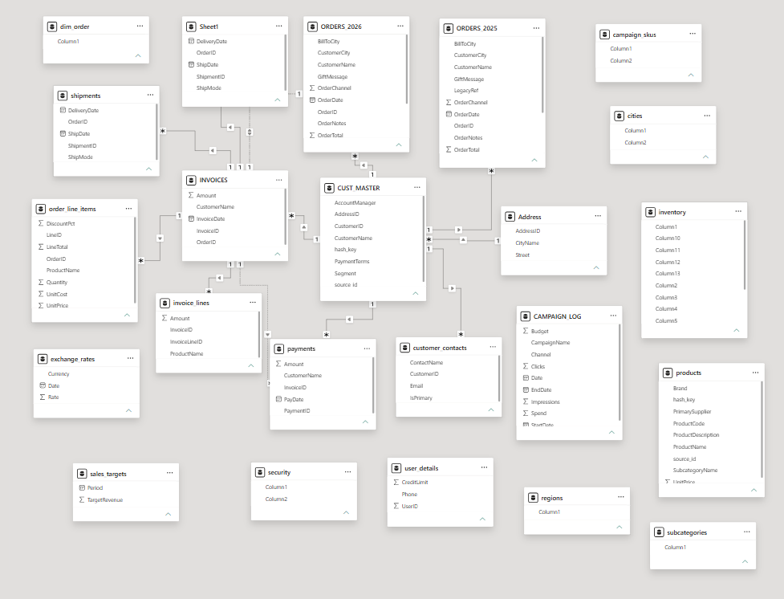
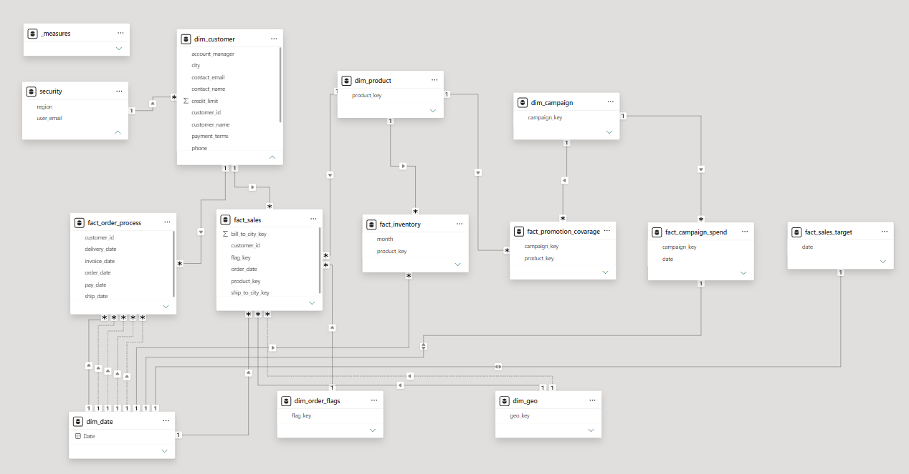

# Power BI Data Modeling: The Nightmare Data Model

## Overview

Raw business data rarely arrives ready for analysis. In this project, a company's information is scattered across **23 messy Excel sheets**, with test records, duplicate products, and customer data split across several tables. Reports built directly on top of it can look right while their totals are inflated or their filters misbehave.

My goal was to turn that dataset into a clean, trustworthy **star-schema model** in Power BI, validating the numbers at every step. This project turns a 23-sheet Excel dataset into a structured Power BI model for analyzing sales, inventory, campaigns, order processing, and targets. I focused on understanding the source data, separating business entities from transactions, and making the results easier to validate.

The main deliverable is the data model in [`project_datamodel.pbix`](project_datamodel.pbix). Its two report pages check totals and filters. 

**Technologies and concepts used**

| Tool / concept | How it was used |
| --- | --- |
| **Power BI** | Model view, relationships, and report pages used to check totals and filters |
| **Power Query (M)** | Exploring, cleaning, and transforming the 23 source sheets |
| **Data modeling** | Separating business entities (dimensions) from events (facts), and defining the grain of each table |
| **Star schema** | Dimensions and facts organized in a fact constellation, following dimensional modeling practices |

## The problem

The [`dataset.xlsx`](dataset.xlsx) workbook contains 23 sheets. It resembles a raw export from several business systems, with related information split across multiple places:

| Business area | Examples from the source workbook | Modeling question |
| --- | --- | --- |
| Customers | `CUST_MASTER`, `customer_contacts`, `Address`, `user_details` | Which attributes belong in one customer dimension, and which records should be kept? |
| Orders and sales | `ORDERS_2025`, `ORDERS_2026`, `order_line_items` | What does one row of the sales fact represent, and how do order headers relate to lines? |
| Products | `products`, `subcategories` | How can products be described consistently without duplicate matches? |
| Operations | `INVOICES`, `invoice_lines`, `payments`, `shipments` | How should order, invoice, payment, and delivery events be analyzed? |
| Marketing and planning | `CAMPAIGN_LOG`, `campaign_skus`, `sales_targets` | How can campaign activity and targets be analyzed beside sales? |

The source data includes test records and duplicate products, while its related fields are scattered across sheets. These issues matter because a report can look correct while its totals are inflated or its filters behave unexpectedly.

## What I built

I organized the Power BI model around business entities and events:

| Model area | Tables visible in my PBIX |
| --- | --- |
| Dimensions | `dim_customer`, `dim_product`, `dim_geo`, `dim_order_flags`, `dim_campaign`, `dim_date` |
| Facts | `fact_sales`, `fact_inventory`, `fact_campaign_spend`, `fact_promotion_coverage`, `fact_order_process`, `fact_sales_targets` |
| Supporting tables | `_measures`, `security` |

The **dimensions** describe who, what, where, and when. The **facts** represent business activity or targets. Keeping those roles separate makes the model easier to read and helps avoid ambiguous paths between facts. With several fact tables, the result is closer to a fact constellation than a single small star.

## Project workflow

1. **Explored the source.** Reviewed the 23 sheets to identify keys, repeated fields, and the meaning of each row before modeling relationships.
2. **Organized dimensions.** Created dedicated model tables for customers, products, geography, campaigns, order flags, and dates.
3. **Separated business events.** Represented sales, inventory, campaign spend, promotion coverage, order processing, and sales targets as distinct facts because they have different levels of detail.
4. **Added analytical checks.** Used the date dimension, core measures, and simple report visuals to compare values across time and keep important totals visible.
5. **Considered access and validation.** Included a `security` table in the model. The active role configuration should be checked in Power BI Desktop before claiming that row-level security is implemented.

## Model transformation

### Before

The original model had many source tables and relationships that were difficult to follow.

### After

The reorganized model separates dimensions and facts so the relationships are easier to inspect.

## Lessons Learned

- **From theory to practice.** I had already read part of *The Data Warehouse Toolkit* by Ralph Kimball and Margy Ross, including the star schema, the peculiarities of dimension and fact tables, and special designs such as factless fact tables and accumulating snapshots. This was the first time I applied those ideas in a real project, where I had to deal with data validation, transformation, and cleaning.
- **Solid star-schema knowledge.** Building the model end to end consolidated what I knew about star-schema modeling, such as keeping dimensions and facts in separate roles and connecting facts only through shared dimensions.
- **Define standards before starting.** Agreeing on conventions up front saves rework later. Examples are `snake_case` names for tables and columns and a single format for dates, among others.
- **Explore the data before changing it.** Understanding what each table means before touching it avoids cleaning steps that have to be undone.
- **Understand the grain of every table.** An order, an order line, an inventory record, and a campaign record describe different events. Treating them as interchangeable can duplicate values.
- **Validate the numbers while building.** A sales total in a simple visual gives a baseline to compare after each merge and relationship change. Duplicate product matches can otherwise inflate results without being obvious.
- **Treat security as something to test.** A security mapping table is only part of the solution; access rules need to be verified by viewing the report as the intended user.

## Data source credit

The Nightmare Data Model dataset and project scenario were created by [Baraa Khatib Salkini (Data with Baraa)](https://www.youtube.com/watch?v=0A2k62YEbfI). This repository contains my Power BI model built from that source material.
